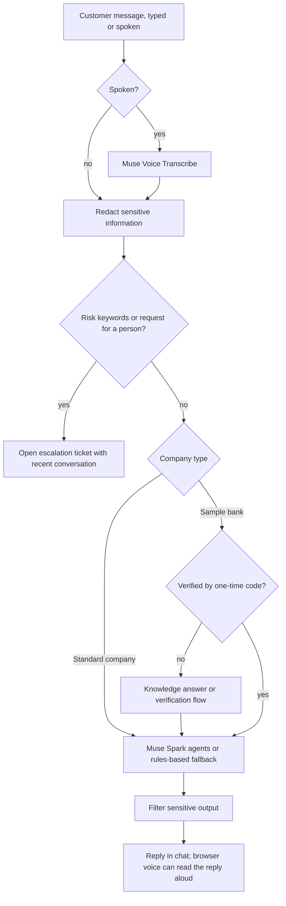

# Mvela AI

**AI-powered customer support for businesses with a website.** Mvela helps small and medium-sized businesses, startups, and other teams answer common customer questions, make support available beyond business hours, and hand conversations to a person when needed.

Built for the Meta AI Developer Hackathon. The AI models used by this project are Meta Muse Spark and Muse Voice Transcribe.

- **Demo video (3 min):** `[add link]`
- **Live site:** [https://artasylum.xyz](https://artasylum.xyz)
- **Create an account:** [https://artasylum.xyz/signup](https://artasylum.xyz/signup)
- **Demo shop guide:** [apps/demoshop/README.md](apps/demoshop/README.md)
- **Team:** Dalitso Banda

> All data in this repository is synthetic. There are no real customers, accounts, or bank records.

---

## Before the event and during it

| Before the hackathon | Built during the hackathon |
|---|---|
| A front-end prototype: marketing pages, dashboard screens and a chat-widget design, running on mock data with no back end and no AI. | The whole working product: the API and database, company sign-up, AI-powered support, voice, integrations, and the dashboard. |

The git history shows the order of work.

---

## The problem

Many businesses rely on a small team to answer the same questions about products, services, opening hours, pricing, policies, and order status. When support staff are busy or unavailable, customers wait or give up.

## What Mvela does

| For customers | For businesses |
|---|---|
| Chat widget that can be added to a website | Sign up and manage a separate business workspace |
| Optional voice conversation | Add FAQs, hours, prices, and policies to a knowledge base |
| Clear AI-assistant labeling and a way to reach a human | Publish the widget with a one-line snippet |
| Order and stock answers from the business's own system | Connect order or stock systems as read-only Lookups |
| No need to repeat the conversation when a request is escalated | Configure team roles, assistant name, and tone |

Mvela is intended as a general customer-support starting point for SMEs, startups, and other website owners. The included sample bank is a demo integration, not the product's target audience: it uses synthetic data to show how the assistant can interact with a business system.

There are two company modes in the app:

- **Standard company:** answers from that company's knowledge base, can run its configured lookups, and can escalate to a human.
- **Sample bank:** a demo company with one-time-code verification and read-only account tools backed by synthetic data.

---

## AI models and other features

All AI runs through Meta's hosted Model API. No other AI service is called, and no open-weight model is run locally.

### Meta model calls

Model calls go to the Meta Model API (`https://api.meta.ai/v1`, set by `META_API_BASE`) using `META_API_KEY`. The chat request format is OpenAI-compatible; the models are Meta's.

| Model | Default name (environment variable) | Where it runs | What it does |
|---|---|---|---|
| Muse Spark specialist | `muse-spark-1.1` (`META_MODEL`) | Meta's API | Answers customer messages and can call server-side tools such as knowledge search, lookups, and escalation. |
| Muse Spark triage | Same model or `META_TRIAGE_MODEL` | Meta's API | Classifies the latest messages by intent (question, account, complaint, fraud, other). |
| Muse Spark reviewer | Same model or `META_REVIEW_MODEL` | Meta's API | Checks a draft answer against available evidence and response rules, and approves, rewrites, or blocks it. |
| Muse Voice Transcribe | `muse-voice-transcribe-1.0` (`META_STT_MODEL`) | Meta's API | Transcribes audio for voice conversations. |

The triage agent classifies the request, the specialist drafts a response and may use tools, and the reviewer checks the response. Triage and review are best-effort; if either fails, the specialist still answers.

### Features that do not use an AI model

| Feature | How it works |
|---|---|
| Spoken replies | The browser's built-in `speechSynthesis` reads replies aloud, using the device's own on-device voices; no text-to-speech API or model is used. This is an operating-system/browser feature. |
| Microphone capture | Browser audio APIs capture speech; a volume threshold detects when speaking starts and stops. |
| Knowledge search | Keyword scoring over the business's entries; it does not use embeddings. |
| Sensitive-data redaction | Rules remove detected PINs, passwords, and card numbers before storage or model calls. |
| Risk rules | Keyword checks can send fraud, complaint, or human-help requests to a person before the model runs. |
| Rules-based fallback | Keyword intent detection and knowledge answers can work without external model calls. |
| One-time codes | Generated and hashed by the server, with expiry and attempt limits. |

### Other integrations

| Service | Use |
|---|---|
| Africa's Talking | Optional SMS delivery for one-time codes. |
| Resend | Optional email delivery for one-time codes. |
| A business's HTTPS API | Optional configured lookups, such as an order-status endpoint (see the demo shop below). |
| Bank REST API | Optional integration for the sample-bank demo. |

---

## How a message flows



Tools available to the assistant:

- `search_knowledge` and `escalate_to_human`: available to every chat.
- `get_account_summary`, `get_card_status`, `get_recent_transactions`, `get_transaction_status`: sample-bank demo only, and only after verification. These are read-only.
- Company lookups (`lookup_*`): only the lookups configured by that company.

The AI cannot move money, block cards, or change records. It can only read permitted information or hand a conversation to a person.

---

## Run locally

Requirements: Node.js 20 or newer. A Meta Model API key is optional; without one, the app uses the rules-based fallback.

```bash
git clone https://github.com/Dalliso-banda/MvelaAI.git
cd MvelaAI
npm install
cp apps/api/.env.example apps/api/.env
```

Edit `apps/api/.env` (this file is git-ignored; never commit a real key):

```bash
META_API_KEY=your-meta-key      # enables Muse Spark and Muse Voice Transcribe
ADMIN_EMAIL=you@example.com     # first owner account, created on first start
ADMIN_PASSWORD=choose-a-strong-password
```

Start the app:

```bash
npm run dev
```

- Web app: http://localhost:5173
- API: http://localhost:4000 (also serves the built web app in production)

Sign in at `/login` with the admin account, or create a business at `/signup`.

**Check your key (optional):**

```bash
cd apps/api && set -a && . ./.env && set +a
curl -s https://api.meta.ai/v1/chat/completions \
  -H "Authorization: Bearer $META_API_KEY" -H 'content-type: application/json' \
  -d '{"model":"muse-spark-1.1","messages":[{"role":"user","content":"Say hello"}],"max_tokens":20}'
```

The API log also says `FELL BACK to the rules agent` if a model call fails.

**Try a business workspace:** Sign up at `/signup`, add a few entries under **Knowledge base**, open **Live demo**, and ask about them. To try the website widget, open **Publish widget**, switch it on, copy the snippet, and add it to a test page.

**Try the sample bank:** Sign in as the admin (company 1), open **Live demo**, and ask "what is my balance?". This demo uses synthetic data; `GET /api/demo/customers` lists the demo customers.

**Try voice:** In the chat window, choose the call option. The microphone requires HTTPS or `localhost`, and the server needs `META_API_KEY` for transcription.

### Try Lookups with the demo shop

[`apps/demoshop/README.md`](apps/demoshop/README.md) has the complete demo shop setup and Lookups instructions.

`apps/demoshop` is a fake online shop ("Chalo Threads") with made-up orders `TZ-1001` to `TZ-1006` and a small stock API. It shows how a company connects its own system, so the assistant can answer order and stock questions. It is not required to run Mvela.

1. `cp apps/demoshop/.env.example apps/demoshop/.env`
2. In Mvela, sign up, open **Publish widget**, switch it on, and put the key in `WIDGET_KEY` in `apps/demoshop/.env`.
3. For local testing only, add `ALLOW_PRIVATE_CONNECTORS=true` to `apps/api/.env` and restart the API. (Lookups normally require public HTTPS addresses.)
4. `npm run dev:shop` and open http://localhost:4200. The chat bubble appears bottom right.
5. In the dashboard, open **Lookups** and add two lookups, using header `x-shop-key` with secret `demo-shop-key`:

| | Order status | Stock check |
|---|---|---|
| Name | `order_status` | `stock_check` |
| Address | `http://localhost:4200/api/orders/{order_id}` | `http://localhost:4200/api/stock/{item}` |
| Customer provides | `order_id` | `item` |
| Fields the AI may share | `order_id, status, estimated_delivery, carrier, tracking_number, delay_reason, refund_status, pickup_location, items` | `item, in_stock, sizes, price_zmw, restock` |

Try: "Where is TZ-1001?", "Why is TZ-1004 late?", "What happened to TZ-1005?", "Is the winter coat in stock?". The shop's order API also returns a customer email and an internal note; they are not returned to the AI.

### Production

```bash
npm run build -w apps/web
cd apps/api && node --env-file-if-exists=.env src/index.js
```

The API serves the built web app. Put HTTPS in front (nginx or Caddy), and set `PUBLIC_API_URL` and `CLIENT_ORIGIN` to your public address. `ALLOW_PRIVATE_CONNECTORS` must stay off in production.

### Mock bank (optional)

`apps/mockbank` is a stand-in for a bank REST API with different field names and units. Run `npm run dev:bank`, then set `BANK_MODE=http` in `apps/api/.env` to try the adapter.

---

## Configuration

| Variable | Purpose |
|---|---|
| `META_API_KEY` | Meta Model API key. Empty means rules-based fallback only. |
| `META_MODEL`, `META_TRIAGE_MODEL`, `META_REVIEW_MODEL` | Muse Spark model names. |
| `META_STT_MODEL`, `VOICE_LANGUAGES` | Muse Voice Transcribe model and optional language hint. |
| `META_REASONING_EFFORT` | Optional reasoning setting, for example `minimal`. |
| `MULTI_AGENT` | `true` (default) enables triage, specialist, and reviewer; `false` uses one model call per message (faster, cheaper). |
| `ADMIN_EMAIL`, `ADMIN_PASSWORD`, `JWT_SECRET` | First owner account and session signing. Use a long random `JWT_SECRET`. |
| `OTP_CHANNEL` | `demo`, `sms`, `email`, or a comma-separated list. `demo` must not be used in production. |
| `BANK_MODE` | `demo` (synthetic data) or `http` (sample bank REST API). |
| `PUBLIC_API_URL`, `CLIENT_ORIGIN` | Public addresses used by the widget and chat window. |
| `SIGNUP_ENABLED` | Set to `false` to close business sign-up. |
| `ALLOW_PRIVATE_CONNECTORS` | Development only: lets Lookups call `http://localhost`. Keep off in production. |

See `apps/api/.env.example` for all settings, and `docs/` for details on connectors and multi-company design.

## Tests

```bash
npm test
```

The API test suite covers verification and code limits, customer and company isolation, redaction, escalation, sign-in and roles, the widget, connector safety, the multi-agent flow, voice transcription, and bank adapters.

## Security and privacy design

- **Company isolation:** dashboard queries are scoped to the signed-in user's company. Public chats are associated with the company whose widget is used.
- **Restricted tools:** server-side tools use the session's company and verified customer. Account tools are unavailable before verification.
- **Redaction:** detected PINs, passwords, and card numbers are removed from messages before storage and model calls.
- **Sandboxed lookups:** HTTPS only, private/internal addresses refused, redirects blocked, and response size and time limited. Only allow-listed fields are returned, and the lookup secret is stored encrypted.
- **Reviewer agent:** a second model call checks each answer that used data against the evidence before it is sent.
- **Operational controls:** rate limits apply to chat, voice, sign-in, and sign-up. Tool calls, agent steps, escalations, and admin actions are logged.
- **Voice:** audio is validated, size-capped, and discarded after transcription.

## Limitations

- Browser voice output depends on the device's built-in speech synthesis; quality varies by device.
- Voice and chat quality depend on Meta's API being reachable; if it is not, the app falls back to the simpler rules-based assistant.
- The assistant's answers depend on the quality and coverage of the business's knowledge entries and configured lookups.
- Standard companies do not have customer sign-in. Configure lookups to expose only low-risk information; an order number alone is a weak check, so do not expose personal data without adding an appropriate verification step.
- Data is stored in SQLite, suitable for a pilot on one server with backups; larger deployments may need PostgreSQL and additional operational work.
- "Hours saved" on the overview is an estimate, not a measured result.
- Knowledge search is keyword-based and matches words rather than meaning.
- This project is a prototype. Use synthetic data for evaluation and complete a security and privacy review before connecting real customer data or deploying for production use.

## Repository layout

```
apps/api
  src/routes/  Route composition, public endpoints, and admin endpoints grouped by resource
    admin/      Overview, conversations, escalations, knowledge, and connector routes
  src/          API services and integrations (agent, llm, auth, database, tools, voice, etc.)
  test/         API and integration tests
apps/web       React + MUI: marketing site, dashboard, chat widget, and voice call
apps/demoshop  Fake online shop with an order API, for trying Lookups
apps/mockbank  Stand-in bank REST API for testing the adapter
docs           Connectors and multi-company notes
```
