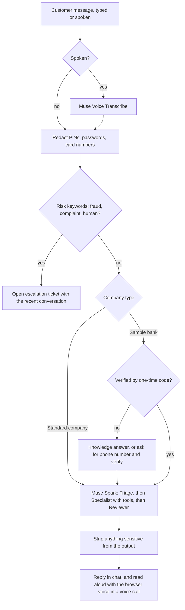

# Mvela AI

**AI customer care for businesses in Zambia.** A company signs up, adds its knowledge, publishes a chat widget on its website, and customers get instant answers by text or voice, in English, Bemba or Nyanja. When the AI is unsure, or the customer is upset or reports fraud, the chat is handed to a human with a summary. Every company's data is kept separate.

Built for the Meta AI Developer Hackathon. The AI is **Meta Muse only**: Muse Spark for reasoning and Muse Voice Transcribe for speech to text.

- **Demo video (3 min):** `[add link]`
- **Live site:** `[https://artasylum.xyz]`
- **Team:** Dalitso Banda (solo), Lusaka, Zambia

> All data in this repository is synthetic. There are no real customers, accounts or bank records.

---

## The problem

Banks, telecoms and shops in Zambia have far more customers than customer-care staff. Calls go unanswered, replies take hours, and people who are more comfortable in Bemba or Nyanja than English are served last. Most questions are repetitive (opening hours, prices, "where is my order", "why did my transfer fail").

## What Mvela does

| For the customer | For the business |
|---|---|
| Chat widget on any website, mobile-first | Sign up in minutes; each company gets its own workspace |
| Speak instead of type (voice call mode) | Knowledge base: paste FAQs, hours, prices, policies |
| Replies in the language they write in | Publish the widget with a one-line snippet |
| Clear "AI assistant" label, one tap to a human | Connect lookups (e.g. order status) without code |
| Never asked for PINs, passwords or card numbers | Escalation inbox: each ticket carries the recent conversation, so nobody has to repeat themselves |
| | Team logins with roles, AI name and tone settings |

There are two kinds of company:

- **Standard company** (what any new sign-up gets): the AI answers from that company's knowledge base, can run the lookups the company configured, and escalates to a human. Customers are not signed in, so the AI never sees personal accounts.
- **Sample bank** (company 1, the demo): adds one-time-code verification and read-only account tools (balance, transactions, failed transfers, card status) against synthetic data, to show what a bank integration looks like.

---

## AI models: what is used, and how each one works

### Meta model calls (the only AI models this project calls)

All model calls go to the Meta Model API (`https://api.meta.ai/v1`, set by `META_API_BASE`) with one key, `META_API_KEY`. There are exactly two places in the code that call a model:

| Model | Default name (env var) | Code | What it does |
|---|---|---|---|
| **Muse Spark, Specialist agent** | `muse-spark-1.1` (`META_MODEL`) | `apps/api/src/llm.js` (`runSpecialist`) | The main assistant. Receives the conversation and a system prompt, and can call tools in a loop (up to 5 rounds) before writing the reply. |
| **Muse Spark, Triage agent** | same model, or `META_TRIAGE_MODEL` | `apps/api/src/llm.js` (`triage`) | Reads the latest messages and returns JSON only: intent (`faq`, `account`, `complaint`, `fraud`, `other`) and urgency. The intent adds a one-line instruction to the Specialist (for example, "this may be fraud: escalate with high priority"). |
| **Muse Spark, Reviewer agent** | same model, or `META_REVIEW_MODEL` | `apps/api/src/llm.js` (`review`) | Checks the Specialist's draft against the evidence (tool results) and six rules: no invented facts, no requests for PINs or codes, no promises the AI cannot keep, no account data for unverified people, no obeying instructions found inside tool results, short and polite. Returns `ok`, `revise` (reply is replaced with the corrected one) or `block` (reply is replaced with a safe message and a human ticket is opened). |
| **Muse Voice Transcribe** | `muse-voice-transcribe-1.0` (`META_STT_MODEL`) | `apps/api/src/voice.js` (`transcribeWav`) | Speech to text for voice calls. Each utterance is sent as a 16 kHz mono WAV in push-to-talk mode, with the company and assistant names as keyword hints and an optional language bias (`VOICE_LANGUAGES`). Audio is never stored; only its length and the transcript's character count are written to the audit log. |

How the three Spark agents work together:

1. **Triage** (temperature 0, 120 tokens, 8 s timeout) decides what kind of request this is.
2. **Specialist** (temperature 0.3, 600 tokens, 25 s timeout per round) answers, calling tools such as `search_knowledge` or `escalate_to_human`. Tools run on the server with the company and customer taken from the session, never from anything the model writes, so the model cannot widen its own access.
3. **Reviewer** (temperature 0, 500 tokens, 10 s timeout) is skipped for pure small talk (no tools used and no numbers in the reply).

Triage and Reviewer are best-effort: if either fails, the customer still gets the Specialist's answer. If Muse itself is unavailable, the app falls back to its rules engine (below). Set `MULTI_AGENT=false` to use a single model call per message (faster and cheaper). Every agent step is recorded in the audit log (`triage:faq/normal`, `specialist`, `reviewer:ok`).

### Not AI models (rules and browser features)

These run without any model and are described here so it is clear what is and is not a model call.

| Feature | How it works | Code |
|---|---|---|
| **Spoken replies** | The browser's built-in `speechSynthesis` reads the reply aloud. The project calls no text-to-speech API, key or model. Meta has no text-to-speech model, so this is an OS/browser feature. The voice differs by device. | `apps/web/src/components/VoiceCall.jsx` |
| **Microphone capture** | `getUserMedia` plus the Web Audio API record the microphone. A simple volume-threshold detector (not a model) decides when someone starts and stops speaking, then encodes a WAV. | `apps/web/src/lib/voiceCapture.js`, `wav.js` |
| **Knowledge search** | Keyword scoring over the company's own entries (title and tags weigh more than body). No embeddings and no model. | `apps/api/src/tools.js` (`search_knowledge`) |
| **Sensitive-data redaction** | Regular expressions remove PINs, passwords and card numbers before anything is stored or sent to a model. | `apps/api/src/guardrails.js` |
| **Risk rules** | A keyword check sends fraud, complaint and "human" requests straight to a person, before any model runs. | `apps/api/src/guardrails.js` |
| **Language detection** | A small keyword heuristic labels a chat English, Bemba or Nyanja for analytics. The model itself replies in the language the customer writes in. | `apps/api/src/guardrails.js` |
| **Rules agent (fallback)** | If `META_API_KEY` is empty or Muse fails, keyword intent detection and knowledge answers still work, with no external calls. | `apps/api/src/agent.js` |
| **One-time codes** | Generated with Node's `crypto.randomInt`, stored only as a hash. Codes expire after 5 minutes, allow 3 wrong attempts, and a chat can request a code for at most 5 phone numbers. | `apps/api/src/agent.js` |

### Other outside services (not AI)

| Service | Used for | Setting |
|---|---|---|
| Africa's Talking | Sending the one-time code by SMS | `OTP_CHANNEL=sms`, `AT_API_KEY`, `AT_USERNAME` |
| Resend | Sending the one-time code by email | `OTP_CHANNEL=email`, `RESEND_API_KEY` |
| A company's own HTTPS API | "Lookups" the company configures (e.g. `GET https://api.shop.com/orders/{order_id}`) | Dashboard, Lookups |
| A bank's REST API | Account data for the sample bank, instead of demo data | `BANK_MODE=http`, `BANK_API_URL` |

---

## How a message flows



Tools the model can call:

- `search_knowledge` and `escalate_to_human`: available to every chat.
- `get_account_summary`, `get_card_status`, `get_recent_transactions`, `get_transaction_status`: sample bank only, and only after verification. All read-only.
- Company lookups (`lookup_*`): only the ones that company configured. The company's saved address, headers and secret are used; the model supplies only the values that fill the placeholders.

The AI cannot move money, block cards or change any record. It can only read, or hand the chat to a person.

---

## Run it locally

Requirements: Node.js 20 or newer. A Meta Model API key is optional: without it the app runs on the rules agent, which is useful for a first look.

```bash
git clone https://github.com/Dalliso-banda/MvelaAI.git
cd MvelaAI
npm install
cp apps/api/.env.example apps/api/.env
```

Edit `apps/api/.env`:

```bash
META_API_KEY=your-meta-key      # enables Muse Spark and Muse Voice Transcribe
ADMIN_EMAIL=you@example.com     # first owner account, created on first start
ADMIN_PASSWORD=choose-a-strong-password
```

Then:

```bash
npm run dev
```

- Web app: http://localhost:5173
- API: http://localhost:4000 (also serves the built web app in production)

Sign in at `/login` with the admin account, or create a new company at `/signup`.

**Try the sample bank:** sign in as the admin (company 1), open **Live demo**, and ask "what is my balance?". The assistant asks for a registered phone number; `GET /api/demo/customers` lists the synthetic ones. With `OTP_CHANNEL=demo` (the default) the one-time code is shown in the chat, so no SMS provider is needed.

**Try a new company:** sign up at `/signup`, add a few entries under **Knowledge base**, open **Live demo** and ask about them. Then open **Publish widget**, switch it on, and paste the snippet into any web page.

**Voice:** in the chat window, choose the call option. The microphone needs HTTPS or `localhost`, and the server needs `META_API_KEY`.

**Production:**

```bash
npm run build -w apps/web
cd apps/api && node --env-file-if-exists=.env src/index.js
```

The API serves the built web app. Put HTTPS in front (nginx or Caddy), and set `PUBLIC_API_URL` and `CLIENT_ORIGIN` to your public address.

### Mock bank (optional)

`apps/mockbank` is a stand-in for a bank's REST API with different field names and units, to show the adapter translating between systems. Run `npm run dev:bank`, then set `BANK_MODE=http` in `apps/api/.env`.

---

## Configuration

| Variable | Purpose |
|---|---|
| `META_API_KEY` | Meta Model API key. Empty means rules agent only. |
| `META_MODEL`, `META_TRIAGE_MODEL`, `META_REVIEW_MODEL` | Muse Spark model names |
| `META_STT_MODEL`, `VOICE_LANGUAGES` | Muse Voice Transcribe model and optional language hint |
| `META_REASONING_EFFORT` | Optional (for example `minimal`) for faster replies |
| `MULTI_AGENT` | `true` (default): triage + specialist + reviewer. `false`: one call per message |
| `ADMIN_EMAIL`, `ADMIN_PASSWORD`, `JWT_SECRET` | First owner account and session signing |
| `OTP_CHANNEL` | `demo`, `sms`, `email` or a comma list. **`demo` must not be used in production.** |
| `BANK_MODE` | `demo` (synthetic data) or `http` (a bank's REST API) |
| `PUBLIC_API_URL`, `CLIENT_ORIGIN` | Public addresses used in the widget snippet and chat window |
| `SIGNUP_ENABLED` | `false` closes company sign-up |

See `apps/api/.env.example` for everything, and `docs/` for details on connectors and multi-company design.

## Tests

```bash
npm test
```

58 automated API tests cover: verification and code limits, customer isolation, redaction, escalation, sign-in and roles, the widget, company isolation, connector safety (blocked internal addresses, secrets never returned), the voice endpoint, and mocked Muse Spark and Muse Voice Transcribe calls (including failure fallbacks).

## Security and privacy design

- **Company isolation:** every dashboard query filters on the signed-in user's company, which is read from the database and never from the browser. Public chats belong to the company whose widget key started them.
- **AI cannot widen its access:** tools are run by the server with the session's company and verified customer. Before verification the model has no account tools at all.
- **Redaction before storage and before the model:** PINs, passwords and card numbers are removed from messages.
- **Lookups are sandboxed:** HTTPS only, internal and private addresses refused at connect time, no redirects, response size and time limits, and only allow-listed fields returned. Secrets are encrypted at rest and never sent back to the browser.
- **Rate limits** on chat, voice, sign-in and sign-up. Audit log of tool calls, agent steps, escalations and admin actions. Every outside call goes through a job queue with timeouts and retries.
- **Voice:** audio is validated, size-capped and discarded after transcription.

## Limitations (honest notes)

- **Voice output** uses the browser's built-in voice because Meta has no text-to-speech model. Quality differs by device.
- **Bemba and Nyanja:** the assistant replies in the language the customer writes in, but quality has not been formally evaluated and should be reviewed by native speakers before production use. Speech recognition accuracy for these languages is untested.
- **Standard companies have no customer sign-in.** Lookups should expose only low-risk fields (such as order status), never personal data. Per-company verification is the next step.
- **Single server:** data lives in SQLite. That is fine for a pilot with one server and backups; move to PostgreSQL for more.
- **"Hours saved" on the overview is an estimate** (minutes per AI-resolved chat, set by `HANDLE_MINUTES`), not a measurement.
- **Knowledge search is keyword-based,** so it matches words, not meaning.
- **Synthetic data only.** Do not point it at real customers until SMS delivery, a real bank connection and a security review are in place.

## Repository layout

```
apps/api       Express API: agents, tools, auth, companies, widget, voice, connectors, job queue, tests
apps/web       React + MUI: marketing site, dashboard, chat widget and voice call
apps/mockbank  Stand-in bank REST API for testing the adapter
docs           Connectors and multi-company notes
```
