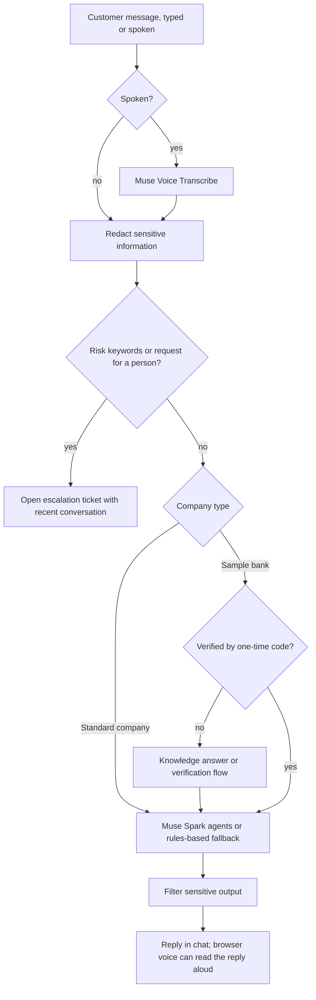

# Mvela AI

**AI-powered customer support for businesses with a website.** Mvela helps small and medium-sized businesses, startups, and other teams answer common customer questions, make support available beyond business hours, and hand conversations to a person when needed. Add your business information, publish a chat widget on your site, and let customers get help by text or voice.

Built for the Meta AI Developer Hackathon. The AI models used by this project are Meta Muse Spark and Muse Voice Transcribe.

- **Demo video (3 min):** `[add link]`
- **Live site:** [https://artasylum.xyz](https://artasylum.xyz)
- **Team:** Dalitso Banda

> All data in this repository is synthetic. There are no real customers, accounts, or bank records.

---

## The problem

Many businesses rely on a small team to answer the same questions about products, services, opening hours, pricing, policies, and order status. When support staff are busy or unavailable, customers can be left waiting. Mvela gives businesses a website chat assistant for routine questions, with a way to escalate conversations that need a person.

## What Mvela does

| For customers | For businesses |
|---|---|
| Chat widget that can be added to a website | Sign up and manage a separate business workspace |
| Optional voice conversation | Add FAQs, hours, prices, and policies to a knowledge base |
| Clear AI-assistant labeling and a way to reach a human | Publish the widget with a one-line snippet |
| No need to repeat the conversation when a request is escalated | Configure supported lookups, team roles, assistant name, and tone |

Mvela is intended as a general customer-support starting point for SMEs, startups, and other website owners. The included sample bank is a demo integration, not the product's target audience: it uses synthetic data to demonstrate how a business-specific connector could work.

There are two company modes in the app:

- **Standard company:** answers from that company's knowledge base, can run its configured lookups, and can escalate to a human.
- **Sample bank:** a demo company with one-time-code verification and read-only account tools backed by synthetic data.

---

## AI models and other features

### Meta model calls

Model calls go to the Meta Model API (`https://api.meta.ai/v1`, set by `META_API_BASE`) using `META_API_KEY`.

| Model | Default name (environment variable) | What it does |
|---|---|---|
| Muse Spark specialist | `muse-spark-1.1` (`META_MODEL`) | Answers customer messages and can call server-side tools such as knowledge search and escalation. |
| Muse Spark triage | Same model or `META_TRIAGE_MODEL` | Classifies the latest messages by intent. |
| Muse Spark reviewer | Same model or `META_REVIEW_MODEL` | Checks a draft answer against available evidence and response rules. |
| Muse Voice Transcribe | `muse-voice-transcribe-1.0` (`META_STT_MODEL`) | Transcribes audio for voice conversations. |

The triage agent classifies the request, the specialist drafts a response and may use tools, and the reviewer checks the response. Triage and review are best-effort; if either fails, the specialist's response can still be returned. If Muse is unavailable or `META_API_KEY` is empty, the app can use its rules-based fallback.

### Features that do not use an AI model

| Feature | How it works |
|---|---|
| Spoken replies | The browser's built-in `speechSynthesis` reads replies aloud; no text-to-speech API or model is used. |
| Microphone capture | Browser audio APIs capture speech; a volume threshold detects when speaking starts and stops. |
| Knowledge search | Keyword scoring over the business's entries; it does not use embeddings. |
| Sensitive-data redaction | Rules remove detected PINs, passwords, and card numbers before storage or model calls. |
| Risk rules | Keyword checks can send fraud, complaint, or human-help requests to a person before the model runs. |
| Rules-based fallback | Keyword intent detection and knowledge answers can work without external model calls. |
| One-time codes | Generated and hashed by the server, with expiry and attempt limits. |

### Other integrations

| Service | Use |
|---|---|
| Africa's Talking | Optional SMS delivery for one-time codes. |
| Resend | Optional email delivery for one-time codes. |
| A business's HTTPS API | Optional configured lookups, such as an order-status endpoint. |
| Bank REST API | Optional integration for the sample-bank demo. |

---

## How a message flows



Tools available to the assistant:

- `search_knowledge` and `escalate_to_human`: available to every chat.
- `get_account_summary`, `get_card_status`, `get_recent_transactions`, `get_transaction_status`: sample-bank demo only, and only after verification. These are read-only.
- Company lookups (`lookup_*`): only the lookups configured by that company.

The AI cannot move money, block cards, or change records. It can only read permitted information or hand a conversation to a person.

---

## Run locally

Requirements: Node.js 20 or newer. A Meta Model API key is optional; without one, the app uses the rules-based fallback.

```bash
git clone https://github.com/Dalliso-banda/MvelaAI.git
cd MvelaAI
npm install
cp apps/api/.env.example apps/api/.env
```

Edit `apps/api/.env`:

```bash
META_API_KEY=your-meta-key      # enables Muse Spark and Muse Voice Transcribe
ADMIN_EMAIL=you@example.com     # first owner account, created on first start
ADMIN_PASSWORD=choose-a-strong-password
```

Start the app:

```bash
npm run dev
```

- Web app: http://localhost:5173
- API: http://localhost:4000 (also serves the built web app in production)

Sign in at `/login` with the admin account, or create a business at `/signup`.

**Try a business workspace:** Sign up at `/signup`, add a few entries under **Knowledge base**, open **Live demo**, and ask about them. To try the website widget, open **Publish widget**, switch it on, and add the provided snippet to a website.

**Try the sample bank:** Sign in as the admin (company 1), open **Live demo**, and ask “what is my balance?”. This demo uses synthetic data; `GET /api/demo/customers` lists the demo customers.

**Try voice:** In the chat window, choose the call option. The microphone requires HTTPS or `localhost`, and the server needs `META_API_KEY` for transcription.

### Production

```bash
npm run build -w apps/web
cd apps/api && node --env-file-if-exists=.env src/index.js
```

The API serves the built web app. Put HTTPS in front (nginx or Caddy), and set `PUBLIC_API_URL` and `CLIENT_ORIGIN` to your public address.

### Mock bank (optional)

`apps/mockbank` is a stand-in for a bank REST API with different field names and units. Run `npm run dev:bank`, then set `BANK_MODE=http` in `apps/api/.env` to try the adapter.

---

## Configuration

| Variable | Purpose |
|---|---|
| `META_API_KEY` | Meta Model API key. Empty means rules-based fallback only. |
| `META_MODEL`, `META_TRIAGE_MODEL`, `META_REVIEW_MODEL` | Muse Spark model names. |
| `META_STT_MODEL`, `VOICE_LANGUAGES` | Muse Voice Transcribe model and optional language hint. |
| `META_REASONING_EFFORT` | Optional reasoning setting, for example `minimal`. |
| `MULTI_AGENT` | `true` (default) enables triage, specialist, and reviewer; `false` uses one model call per message. |
| `ADMIN_EMAIL`, `ADMIN_PASSWORD`, `JWT_SECRET` | First owner account and session signing. |
| `OTP_CHANNEL` | `demo`, `sms`, `email`, or a comma-separated list. `demo` must not be used in production. |
| `BANK_MODE` | `demo` (synthetic data) or `http` (sample bank REST API). |
| `PUBLIC_API_URL`, `CLIENT_ORIGIN` | Public addresses used by the widget and chat window. |
| `SIGNUP_ENABLED` | Set to `false` to close business sign-up. |

See `apps/api/.env.example` for all settings, and `docs/` for details on connectors and multi-company design.

## Tests

```bash
npm test
```

The API test suite covers verification and code limits, customer and company isolation, redaction, escalation, sign-in and roles, the widget, connector safety, and related behavior.

## Security and privacy design

- **Company isolation:** dashboard queries are scoped to the signed-in user's company. Public chats are associated with the company whose widget is used.
- **Restricted tools:** server-side tools use the session's company and verified customer. Account tools are unavailable before verification.
- **Redaction:** detected PINs, passwords, and card numbers are removed from messages before storage and model calls.
- **Sandboxed lookups:** HTTPS only, private/internal addresses refused, redirects blocked, and response size and time limited. Only allow-listed fields are returned.
- **Operational controls:** rate limits apply to chat, voice, sign-in, and sign-up. Tool calls, agent steps, escalations, and admin actions are logged.
- **Voice:** audio is validated, size-capped, and discarded after transcription.

## Limitations

- Browser voice output depends on the device's built-in speech synthesis; quality varies by device.
- The assistant's answers depend on the quality and coverage of the business's knowledge entries and configured lookups.
- Standard companies do not have customer sign-in. Configure lookups to expose only low-risk information; do not expose personal data without adding an appropriate verification flow.
- Data is stored in SQLite, suitable for a pilot on one server with backups; larger deployments may need PostgreSQL and additional operational work.
- “Hours saved” on the overview is an estimate, not a measured result.
- Knowledge search is keyword-based and matches words rather than meaning.
- This project is a prototype. Use synthetic data for evaluation and complete a security and privacy review before connecting real customer data or deploying for production use.

## Repository layout

```
apps/api       Express API: agents, tools, auth, companies, widget, voice, connectors, job queue, tests
apps/web       React + MUI: marketing site, dashboard, chat widget, and voice call
apps/mockbank  Stand-in bank REST API for testing the adapter
docs           Connectors and multi-company notes
```
